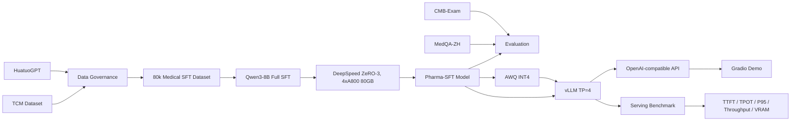

# PharmaLLM

## Overview

PharmaLLM is an engineering project for Chinese medical large language model
fine-tuning and serving. It covers data governance, Qwen3-8B full-parameter
SFT, independent benchmark evaluation, AWQ quantization, vLLM serving, and
serving benchmarks.

This repository intentionally does not commit raw datasets, model weights,
checkpoints, logs, or generated result files. All metrics in reports should be
generated from real runs.

## Highlights

- 80k curated Chinese medical instruction samples.
- 75% general medical data and 25% traditional Chinese medicine data.
- Qwen3-8B full-parameter SFT.
- 4x NVIDIA A800 80GB training with DeepSpeed ZeRO-3 and BF16.
- Independent evaluation on CMB-Exam and MedQA-ZH.
- AWQ INT4 quantization path.
- vLLM tensor-parallel serving with OpenAI-compatible API.
- Prefix cache and serving benchmark experiments.

## System Architecture



## Dataset

Expected dataset layout:

```text
data/
  raw/
    huatuogpt/
    tcm/
  interim/
  processed/
  benchmarks/
    cmb_exam/
    medqa_zh/
```

Raw data should be downloaded manually from the official dataset sources and
placed under `data/raw/`. Benchmark files should be placed under
`data/benchmarks/`. Large files are ignored by git.

## Data Governance

The canonical SFT JSONL schema is:

```json
{
  "id": "huatuo_000001",
  "source": "huatuogpt",
  "category": "general_medical",
  "messages": [
    {"role": "user", "content": "Question"},
    {"role": "assistant", "content": "Answer"}
  ]
}
```

Current implemented modules:

- `pharma_llm.data.schema`: canonical schema helpers.
- `pharma_llm.data.validate`: JSONL schema validation.
- `pharma_llm.data.dedup`: exact duplicate removal using normalized
  `user + assistant` text hashes.

Planned next data modules include source-specific normalization, text cleaning,
length filtering with tokenizer counts, near deduplication, contamination
checks, stratified sampling, and report generation.

## Training

Training is configuration-driven:

- Model config: `configs/model.yaml`
- SFT config: `configs/train_sft.yaml`
- DeepSpeed config: `deepspeed/zero3.json`

The first full training target is Qwen3-8B full-parameter SFT with BF16,
FlashAttention-2, gradient checkpointing, and DeepSpeed ZeRO-3 on 4x A800
80GB GPUs.

## Evaluation

Benchmark targets:

- CMB-Exam
- MedQA-ZH

The project will evaluate the base model before SFT, then evaluate the SFT
model with the same benchmark pipeline. Result files are generated under
`reports/` and should not be hand-edited.

## Deployment

Serving target:

- vLLM OpenAI-compatible API
- Tensor parallel size: 4
- Prefix caching enabled for the optimized run

Service settings live in `configs/serving.yaml`.

## Serving Benchmark

Planned serving metrics:

- TTFT
- TPOT
- End-to-end latency
- P50 / P95 latency
- Output tokens per second
- Request throughput
- Peak GPU memory
- Error rate

## Prefix Cache Ablation

The planned ablation compares prefix caching OFF vs ON with a shared long
medical system prompt and multiple user queries. Results should be generated
from benchmark JSON files into `reports/prefix_cache_ablation.md`.

## Project Structure

```text
configs/        YAML configs for data, model, training, eval, and serving
data/           Local datasets and processed JSONL files, ignored by git
deepspeed/      DeepSpeed ZeRO-3 config
src/            Python package
scripts/        Reproducible command wrappers
tests/          CPU-friendly unit tests
reports/        Generated reports, ignored by git except folders
docs/           Reproduction notes
```

## Quick Start

Create a CPU/dev environment for schema and data pipeline development:

```bash
conda create -n pharma-llm python=3.10 -y
conda activate pharma-llm
python -m pip install --upgrade pip
pip install -e ".[dev]"
pytest -q
```

For the 4x A800 fine-tuning environment, start from a CUDA/PyTorch image or
cluster module compatible with your driver, then install the training stack:

```bash
conda create -n pharma-llm-train python=3.10 -y
conda activate pharma-llm-train
python -m pip install --upgrade pip
pip install -r requirements.txt
pip install flash-attn --no-build-isolation
pip install gpustat tensorboard
pip install -e ".[dev]"
```

Install `vllm` and AWQ packages only after confirming CUDA, PyTorch, and
Transformers compatibility in the target environment:

```bash
pip install vllm
pip install autoawq
```

## Reproduction

Validate a canonical JSONL file:

```bash
python -m pharma_llm.data.validate \
  --input data/interim/huatuogpt_normalized.jsonl \
  --output data/interim/huatuogpt_valid.jsonl \
  --invalid-output data/interim/huatuogpt_invalid.jsonl \
  --report reports/huatuogpt_validation.json
```

Run exact deduplication:

```bash
python -m pharma_llm.data.dedup \
  --input data/interim/merged_valid.jsonl \
  --output data/interim/deduplicated.jsonl \
  --duplicates-output data/interim/exact_duplicates.jsonl \
  --report reports/exact_dedup.json
```

Run the current first-phase checks:

```bash
pytest -q
```

## Results

No benchmark, training, quantization, or serving results are filled in before
real execution. Generated report files will be written under `reports/`.

## Demo

The Gradio demo will call the vLLM OpenAI-compatible API over HTTP. It will not
load the model inside the Gradio process.

## Limitations

This is an engineering repository, not a medical device. Model outputs may be
wrong, incomplete, unsafe, or outdated. Human medical professionals must make
clinical decisions.

## Disclaimer

Do not use this project for diagnosis, treatment, or medication decisions
without qualified medical review.

## License

MIT.

## Citation

Citation metadata will be added after the first public release.

